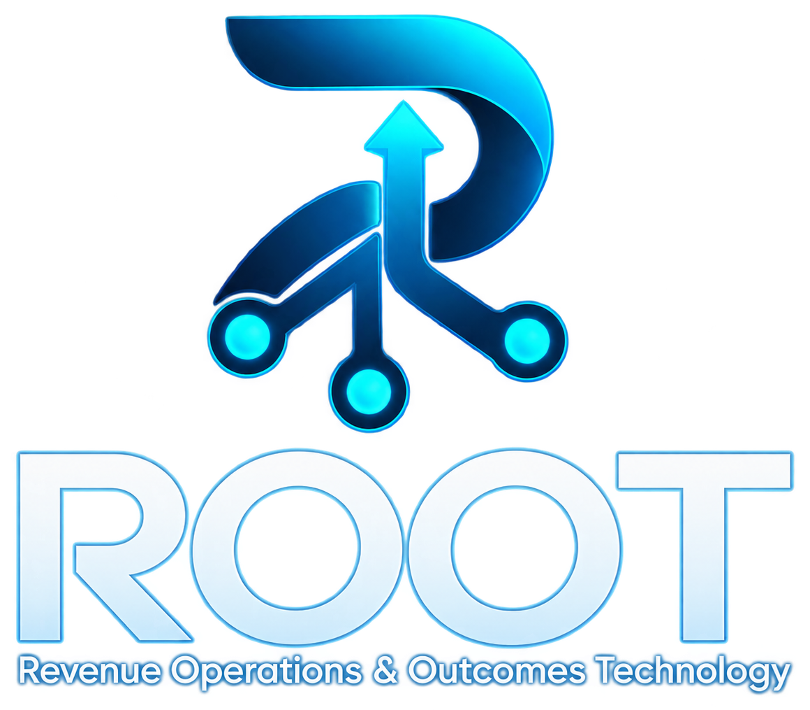
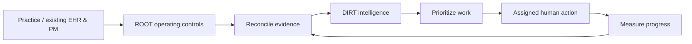
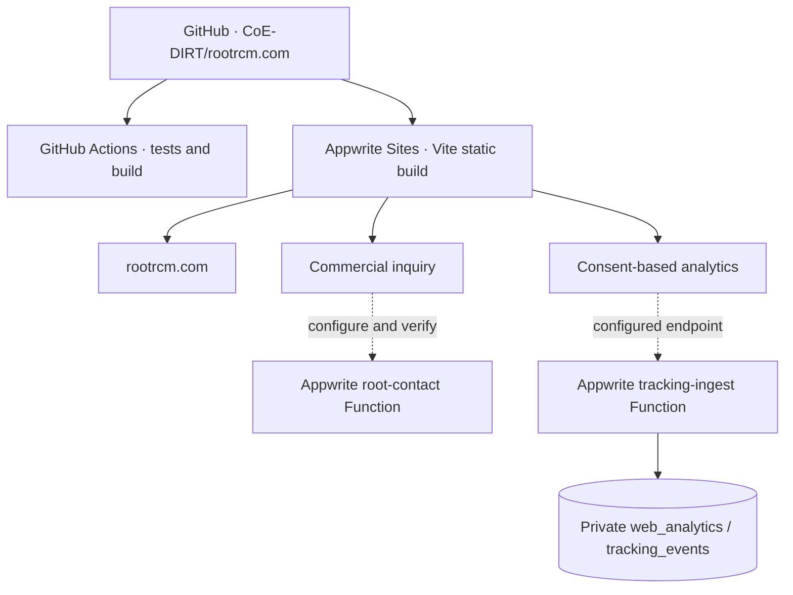

<div align="center">



# ROOT · Healthcare Revenue Intelligence

**Where revenue operations meet actionable data intelligence.**

[](https://rootrcm.com/)
[](https://github.com/CoE-DIRT/rootrcm.com/actions/workflows/ci.yml)
[](https://appwrite.io/)
[](docs/security/public-site-no-phi-boundary.md)

[Explore the website](https://rootrcm.com/) · [Services](https://rootrcm.com/services/) · [About & leadership](https://rootrcm.com/about/) · [Revenue Diagnostic](https://rootrcm.com/diagnostic/) · [Contact](https://rootrcm.com/contact/)

</div>

> **ROOT — Revenue Operations & Outcomes Technology Incorporated** builds practical revenue-operating infrastructure for independent U.S. healthcare practices. We connect managed RCM, payer enrollment, practice operations, automation, and DIRT (Data Intelligence for Revenue Transformation). We do not collect PHI on this public site.

## What ROOT delivers

| Service | Operating result we aim to enable |
| :-- | :-- |
| **Revenue operations** | Transparent claim queues, denial resolution, A/R follow-up and payment-reconciliation controls |
| **Credentialing & enrollment** | Provider/payer readiness, follow-up, revalidation and effective-date visibility |
| **Practice operations** | Clear process ownership, reporting cadence, escalation and accountability |
| **DIRT intelligence** | Evidence-based revenue signals, reconciled metrics, ranked follow-up work |
| **Healthcare technology** | Integration planning, analytics, process automation and monitored implementation |
| **Revenue Optimization Diagnostic** | Fixed-scope, **$2,500** assessment with an evidence-led priorities and 90-day roadmap |

<details>
<summary><strong>▶ How the operating model fits together</strong></summary>



DIRT is an **embedded ROOT capability**, not a separate company or a finished standalone SaaS. Clinical decisions remain with qualified practice professionals.

</details>

## Co-founders & accountability

| Leadership | Role | Verified profiles |
| :-- | :-- | :-- |
| **Aftab Shaukat · Co-Founder** | Principal, Client Solutions & Service Delivery | [LinkedIn](https://www.linkedin.com/in/healthcare-rcm-leader/) · [GitHub @aashaukatc](https://github.com/aashaukatc) |
| **Kashif Ali · Co-Founder** | Senior Operations & Service Delivery Lead | [LinkedIn](https://www.linkedin.com/in/kashif-ali-9874a6237/) |

**Co-founders:** Aftab Shaukat and Kashif Ali (confirmed by ROOT's owner on 21 October 2026). Operational titles follow the approved corporate signatures. A GitHub profile for Kashif has not been verified; none is linked or invented. This public identification does not establish a specific equity allocation or filing status.

**Business:** [info@rootrcm.com](mailto:info@rootrcm.com) · [WhatsApp +1 (302) 506-4685](https://wa.me/13025064685) · [Call +1 (302) 506-4685](tel:+13025064685)

**Correspondence address:** 2803 Philadelphia Pike, Suite B #1864, Claymont, DE 19703, United States. This is a contact address, not a claim that the site is a staffed storefront.

## Application & deployment architecture



| Layer | Implementation |
| :-- | :-- |
| UI | React · Vite · TypeScript/JavaScript · Tailwind CSS · Radix · Lucide |
| Production target | Appwrite Sites `root-website`, Node 22, static adapter |
| CI / QA | GitHub Actions · ESLint · Vitest · Testing Library · Playwright |
| Output | `dist-staging/` |
| Backend | Appwrite Functions `root-contact` and `tracking-ingest`; checkout remains test-mode scaffolding |
| Measurement | First-party analytics and optional consent-gated GA4; verify deployed configuration before claiming active measurement |
| Documents | Docs-as-code in this repo; business originals stay in their controlled Google Drive location |

### Repository guide

```text
.github/workflows/       CI and GitHub Pages workflows
src/                    React application, shared data, route components, SEO
src/v4/routes/          Customer-facing page implementations
src/seo/                Route registry, structured data and metadata
public/brand/           Tracked logos, social cover, icons and favicon
public/media/           Editorial illustrative media with provenance
functions/              Contact, tracking-ingest and optional payment prototypes
docs/                   Governance, architecture, deployment, SEO, security and QA
scripts/                Asset tooling, Appwrite provisioning and analytics guards
dist-staging/            Generated output (never the source of truth)
```

<details>
<summary><strong>▶ Development & quality commands</strong></summary>

Requires Node.js 22 and npm.

```bash
npm ci
npm run dev
npm run lint
npm test
npx tsc --noEmit
npm run build
npx playwright test
```

Review [the quality gates](docs/qa/browser-qa-checklist.md) and [deploy/rollback runbook](docs/deployment/appwrite-cutover.md) before promoting a build. Always stage explicit changed files and use a reviewed pull request.

</details>

<details>
<summary><strong>▶ Status and release distinctions (verified 21 Oct 2026)</strong></summary>

- Connected Appwrite project: `6ac42012001069444210`; site `root-website` exists.
- Appwrite `root-contact` and `tracking-ingest` Functions are enabled, with ready deployments; **live contact-email receipt has not been established**.
- The `web_analytics/tracking_events` table exists, but does not yet demonstrate a production-grade visitor measurement program.
- The October 19 visual/SEO refinements are in [PR #31](https://github.com/CoE-DIRT/rootrcm.com/pull/31), **open, not on production** at this baseline.
- The DNS provider changed in October. Reconfirm current authoritative records, TLS, apex/www routing, Google Workspace MX/SPF/DKIM and the real contact workflow before considering the public deployment healthy.
- The GitHub Pages workflow is retained as a legacy/docs capability. Do not treat it as proof of the present root domain's hosting provider.
- GA4/Google Business Profile/Search Console are **not independently verified** in this repo. Do not infer account activation from code or an email alone.

See [Source of truth & evidence](docs/governance/source-register.md) and [Google readiness](docs/seo/google-platform-readiness.md).

</details>

## Security, claims & contribution rules

- **Never** commit patient data, claim identifiers, credentials, secrets or third-party PII.
- Use synthetic/deidentified examples; label modeled financial results as illustrative.
- No manufactured clients, outcomes, certifications, affiliations, headshots or Google reviews.
- Owner identity, leadership titles, public links and contact numbers must be sourced and reviewed.
- Patient-level work requires appropriate agreements, approved systems and controls outside this public application.
- Production merges follow reviewed CI, QA, release gating and rollback documentation.

## Source navigation

[Architecture](docs/architecture/overview.md) · [Deployment](docs/deployment/appwrite-cutover.md) · [Analytics](docs/deployment/appwrite-analytics.md) · [Service catalog](docs/website/service-catalog.md) · [SEO](docs/seo/README.md) · [Trust boundary](docs/security/public-site-no-phi-boundary.md) · [Leadership evidence](docs/brand/leadership-source-of-truth.md)

---

<div align="center">

**ROOT · Clarity. Cashflow. Care.**

[Website](https://rootrcm.com/) · [LinkedIn](https://www.linkedin.com/company/rootrcm/) · [Email](mailto:info@rootrcm.com) · [WhatsApp](https://wa.me/13025064685)

<sub>© 2026 ROOT Revenue Operations & Outcomes Technology Incorporated · Public marketing repo · No PHI</sub>

</div>
