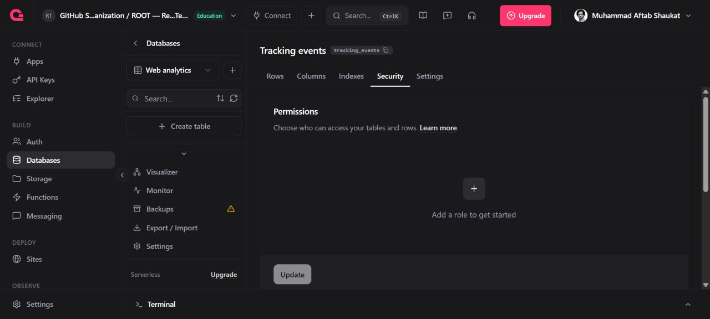
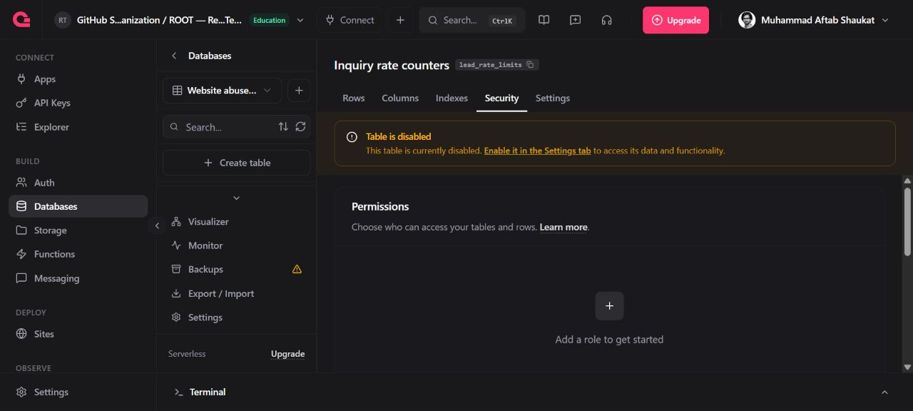

# Phase 5 security and privacy — 26 October 2026

Status: implementation candidate in PR #60; launch blocked by missing owned-relay configuration. No production-complete claim.

## Implemented
- Shared plain-text schema validates and trims the complete owned transport before fetch and again inside the Function. Names 200, email 254/local-part 64, organization 240, need 120, message 5000, metadata 200, verification token 2048 characters. Reject HTML delimiters, control characters, malformed DNS labels, edge/consecutive local-part dots and oversized fields. Unknown owned fields are discarded.
- Form maxlength constraints and the existing no-PHI acknowledgement remain. No marketing checkbox is present; acknowledgement starts false.
- Requested data-use sentence appears at both Contact and Diagnostic forms.
- Email limits use atomic unique row creation (three requests per fixed 15-minute window). HMAC input is normalized email plus time window, with a purpose prefix. Only opaque IDs, a slot number (0–2), and Appwrite timestamps are stored. No email, IP or form content is stored in this table. Storage errors fail closed. Turnstile runs before consuming a slot. A failed delivery consumes a slot to bound retries.
- Generic 409/429 responses do not disclose booking/account existence.
- Existing .env* ignore and VITE_ secret-name build guard retained. React/Vite exposes VITE_ rather than NEXT_PUBLIC_; no framework rewrite. The runtime Appwrite key is injected from the platform header and stays server-side.
- Appwrite WAF rule root-contact-ip enabled: functions/root-contact, per IP, 20 requests/900 seconds, slidingWindow.
- Private counter table provisioned: web_security/lead_rate_limits; permissions [], rowSecurity false, enabled false (server API access remains possible). root-contact prepared with rows.read/rows.write ephemeral scopes, timeout 45 seconds, public execution retained.

## Permissions audit
Appwrite project 6ac42012001069444210 was inspected through API and authenticated console. There are exactly two TablesDB databases and one table in each:

| Table | Client permissions | Row security | Client enabled |
| --- | --- | --- | --- |
| web_analytics/tracking_events | [] | false | true |
| web_security/lead_rate_limits | [] | false | false |

No Appwrite lead or CMS collections exist. Lead delivery is an HTTPS mail relay, and CMS is repository-managed. Public-create leads/public-read CMS rules are therefore not applicable to deployed collections. No unused public-write collection was created.

## Launch blockers and activation
The inspected site variables contain only VITE_EXPERIMENTS_ENABLED and VITE_TRACKING_ENDPOINT. Function and project variable lists are empty. The existing build therefore falls back to FormSubmit; configuring a WAF rule on root-contact does not protect that legacy endpoint.

1. Configure real TURNSTILE_SECRET_KEY, CONTACT_RELAY_URL and CONTACT_RELAY_SECRET in root-contact settings. Use the existing approved authenticated SMTP relay; do not invent credentials or send them in chat. Confirm its signed response contract and accepted request ID.
2. Configure the site's VITE_CONTACT_MODE=owned, VITE_FORM_ENDPOINT with the actual Function domain, and VITE_TURNSTILE_SITE_KEY with the public site key. Rebuild after configuration.
3. After the candidate Function is deployed, enable an hourly schedule (0 * * * *) for its counter cleanup. Do not schedule the old entrypoint. Cleanup removes counters older than 24 hours, up to 500 per execution; monitor backlog and failures.
4. Confirm runtime ephemeral-key row access on the deployed domain, using synthetic data only. Verify concurrent email requests stop at three, IP throttling at the platform, storage failure blocks delivery, and both tables deny anonymous read/write. Verify actual delivery only through an approved test destination.
5. Check that the privacy statement matches actual processor handling, as explained in the existing privacy policy; no sale or unrelated sharing is authorized.
6. Complete required CI/review and record the source-matched deployment before marking this phase accepted.

## Validation and rollback
CI runs lint, strict TypeScript, unit tests, production build, browser QA and Lighthouse. Added tests cover malformed inputs before vendor calls, normalized transport, no enumeration, concurrent atomic counters, storage outage and expiry cleanup.
Local execution was unavailable because the workspace is offline; checks run in GitHub Actions.
Rollback: restore the prior site/Function deployment and prior site variables. Keep the WAF rule and private tables; they do not expose data. Do not delete rate-counter data while the new limiter is live.

## Live counter schema verification — 27 October 2026 (Pakistan time)
Appwrite rejected empty row data with row_missing_data. Added the required integer slot column, bounded to 0–2, and updated the rate limiter to persist that non-personal value. A synthetic row was successfully created with no permissions; repeating its ID returned HTTP 409; the test row was then deleted. This verifies the real storage contract and collision behavior through the administrative API, not the as-yet-unconfigured production Function.

The prior candidate passed 684 unit tests, lint, typecheck, build, browser smoke and the Lighthouse CLS gate (CI run 40340963969). The schema correction is checked in a fresh CI run before PR handoff. Activation remains blocked on the configuration listed above.
